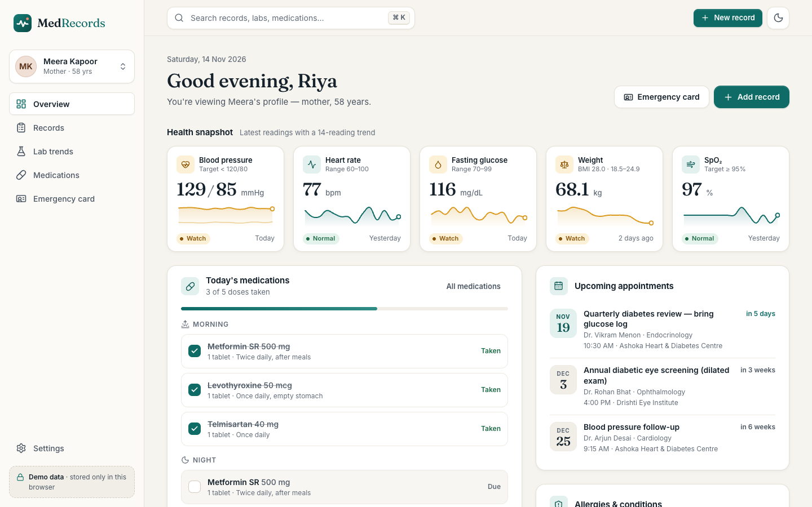
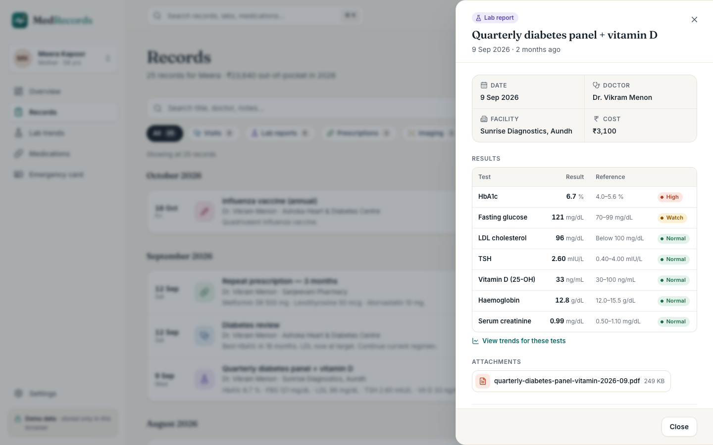
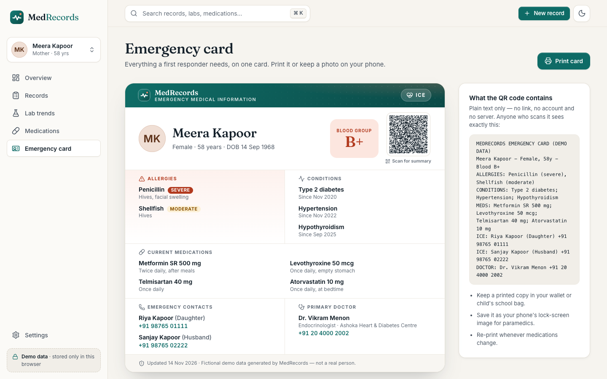
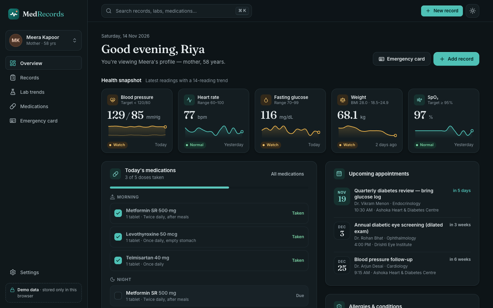
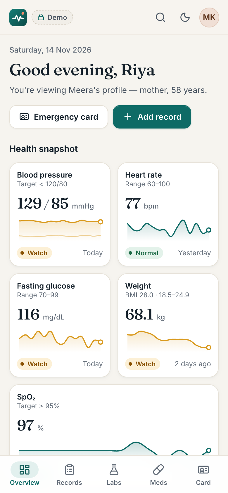

<div align="center">


# MedRecords

**Your family's health, in one calm place.**

A privacy-first personal health record hub for the whole family — visits, lab trends, medications and an emergency card — that runs entirely in your browser.

**[Live demo →](https://gargshishirr.github.io/MedRecords/)**

</div>



> **Demo data only.** Every person, clinician, facility and phone number in the app is fictional. Data is stored only in your browser's `localStorage` — there is no backend, no account and no analytics. MedRecords is a portfolio project, not a medical device, and nothing in it is medical advice.

## Features

- **Family profiles** — switch between Riya (29), her mother Meera (58, type 2 diabetes + hypertension) and her son Kabir (6). Each profile has its own records, vitals, labs, medications, appointments, allergies, conditions, blood group and emergency contacts, with ~18 months of generated history.
- **Overview dashboard** — vitals snapshot (blood pressure, heart rate, fasting glucose, weight/BMI, SpO₂) with sparklines and *Normal / Watch / High* status derived from age- and sex-aware reference ranges; a "today's medications" checklist that persists per day; upcoming appointments; latest lab results with out-of-range flags; allergies & conditions; recent activity.
- **Records timeline** — visits, lab reports, prescriptions, imaging, vaccinations and documents grouped by month, with type filters, full-text search and sorting. Records open in a slide-over detail panel with lab results, notes and (placeholder) attachments. An accessible *Add record* form validates input and saves instantly.
- **Lab trends** — hand-built SVG line charts with the reference range drawn as a shaded band, highlighted out-of-range points, hover **and keyboard** tooltips (Tab / arrow keys), latest value, change vs. previous and a toggleable data table.
- **Medications** — active and past medicines with dose, schedule (morning / afternoon / night), prescriber and start date; a 7-day adherence ring computed from the checklist; refill countdowns that turn amber and coral as supply runs low.
- **Emergency card** — an ID-card style summary (blood group, allergies, conditions, current medicines, emergency contacts, primary doctor) with a QR code that encodes a plain-text summary, plus a print stylesheet that prints just the card.
- **⌘K / Ctrl+K command palette** — jump to any page, record, lab test or medication, switch profiles or toggle the theme from the keyboard.
- **Settings** — light / dark / system theme, JSON export, validated JSON import and one-click reset of the demo data.

## Screenshots

| | |
|---|---|
|  |  |
| **Records timeline** — filter, search and sort by month | **Record detail** — results with reference ranges |
|  |  |
| **Lab trends** — reference band, flagged points, keyboard tooltips | **Medications** — adherence ring, checklist and refills |
|  |  |
| **Emergency card** — printable, with QR summary | **Dark theme** — full token-based theme |

<p align="center">
  
  <br /><em>Mobile layout with a bottom tab bar (360 px and up)</em>
</p>

## Accessibility & design

- Semantic landmarks, a skip link, labelled controls and visible focus rings throughout.
- Modals use the native `<dialog>` element (focus is moved in and restored, <kbd>Esc</kbd> closes, the page behind is inert).
- Charts are keyboard-navigable and backed by real data tables; toasts are announced via an `aria-live` region.
- Every text/background token pair meets WCAG AA contrast in both light and dark themes.
- Motion (count-ups, ring fills, sparkline drawing, dialog transitions) is disabled under `prefers-reduced-motion`.
- Responsive from 360 px to 1440 px+: sidebar on desktop, icon rail on tablets, bottom tab bar on phones, with no horizontal scrolling.

## Tech stack

- **React 18** + **TypeScript** (strict) built with **Vite 5**
- **React Router 6** (`HashRouter`, so deep links work on GitHub Pages)
- Plain CSS with **design tokens** (CSS custom properties) + **CSS Modules** — no UI kit, no Tailwind
- Hand-built **SVG charts** (sparklines, line chart with reference bands, adherence ring)
- **lucide-react** icons, self-hosted **Inter** and **Fraunces** variable fonts via `@fontsource`
- **qrcode** for the emergency-card QR code (lazy-loaded)
- `localStorage` persistence with a versioned schema key (`medrecords:data:v1`) and import validation
- **Vitest** + **Testing Library** + jsdom, **ESLint** (flat config, typescript-eslint, react-hooks)
- **GitHub Actions** → GitHub Pages deployment

## Getting started

Requires Node.js 20+ (22 recommended).

```bash
git clone https://github.com/gargshishirr/MedRecords.git
cd MedRecords
npm install
npm run dev
```

Then open the URL Vite prints (usually http://localhost:5173). The demo data is generated on first load; use **Settings → Reset demo data** to start over.

## Scripts

| Script | What it does |
| --- | --- |
| `npm run dev` | Start the Vite dev server with hot reload |
| `npm run build` | Type-check (`tsc -b`) and build to `dist/` |
| `npm run preview` | Serve the production build locally |
| `npm run lint` | Run ESLint (fails on any warning) |
| `npm test` | Run the Vitest suite once |
| `npm run typecheck` | Type-check without building |

## Project structure

```
.
├── .github/workflows/deploy.yml   # Build, test and deploy to GitHub Pages on push to main
├── docs/screenshots/              # README images
├── public/favicon.svg             # SVG logo mark
├── index.html
├── vite.config.ts                 # base: './' so assets resolve under /MedRecords/
└── src/
    ├── main.tsx / App.tsx         # Entry point, providers and routes
    ├── styles/                    # tokens.css (light + dark design tokens), global.css
    ├── lib/                       # Framework-free logic (unit tested)
    │   ├── types.ts               # Data model
    │   ├── seed.ts                # Deterministic fictional demo data (~18 months)
    │   ├── store.ts               # localStorage persistence, import validation, pure updates
    │   ├── ranges.ts              # Reference ranges + normal/watch/high/low classification
    │   ├── meds.ts                # Dose schedule, adherence and refill calculations
    │   ├── recordForm.ts          # Add-record validation
    │   └── date.ts, format.ts, selectors.ts, hooks.ts
    ├── state/                     # React context: data store, theme, toasts
    ├── components/
    │   ├── shell/                 # App shell: sidebar, top bar, bottom nav, profile switcher
    │   ├── charts/                # Sparkline, LineChart, Ring (pure SVG)
    │   ├── ui/                    # Button, Card, Dialog, Field, Pill, Avatar, EmptyState
    │   └── CommandPalette.tsx, Logo.tsx, …
    └── pages/                     # Overview, Records, Labs, Medications, Emergency, Settings
```

## Deployment

Pushing to `main` runs `.github/workflows/deploy.yml`, which lints, tests, builds and publishes `dist/` to GitHub Pages. Enable it once under **Settings → Pages → Source: GitHub Actions**.

## Privacy

MedRecords never sends data anywhere. Everything — including records you add — lives in your browser's `localStorage` under `medrecords:data:v1` and can be exported, imported or wiped from Settings. Clearing site data removes it completely.

---

Built by [Shishir Garg](https://github.com/gargshishirr).
