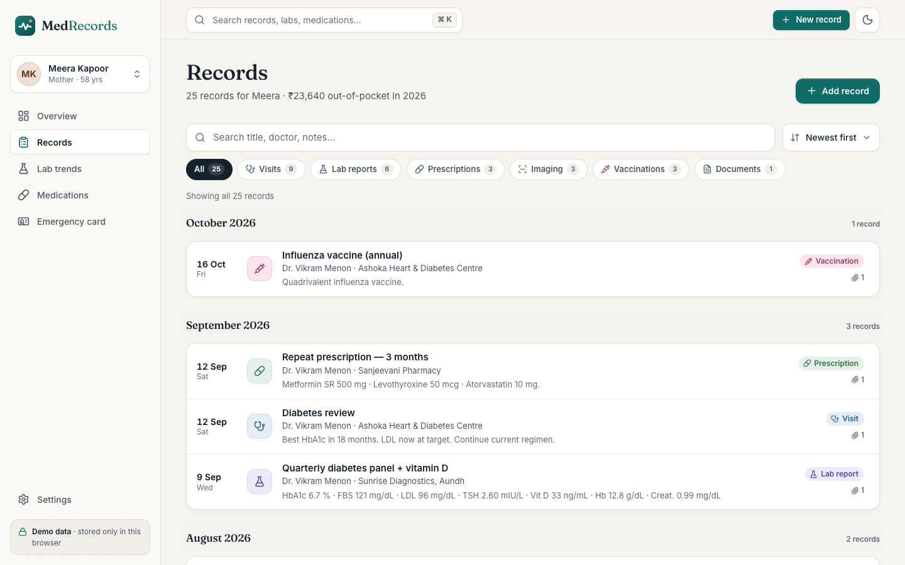
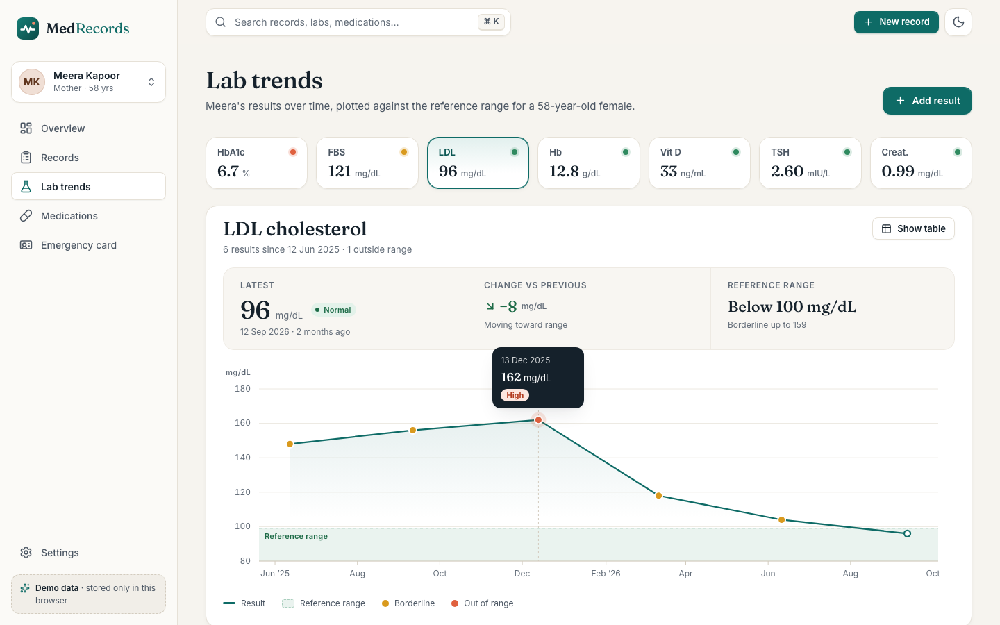
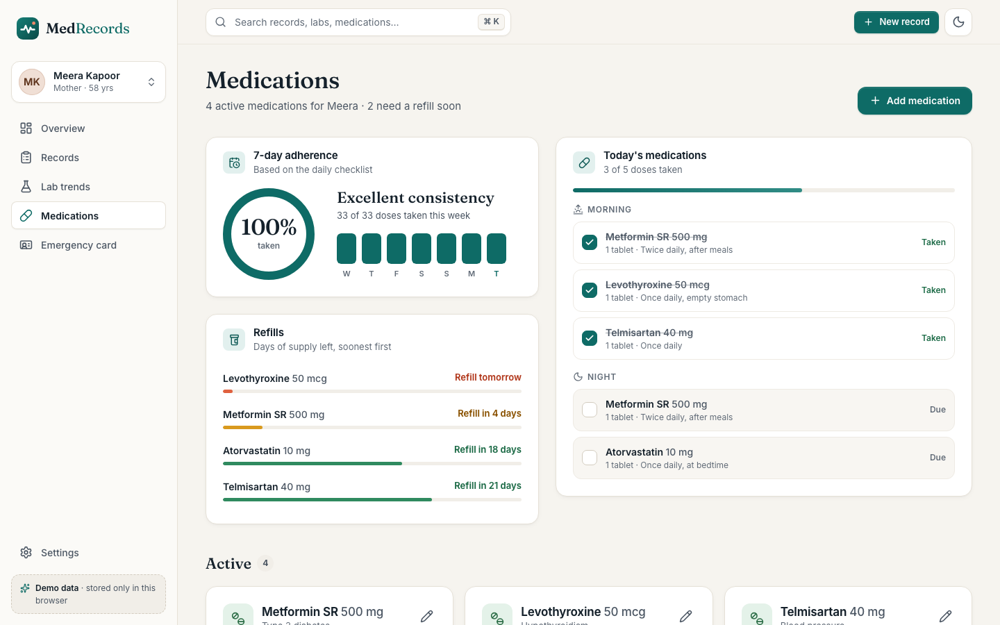
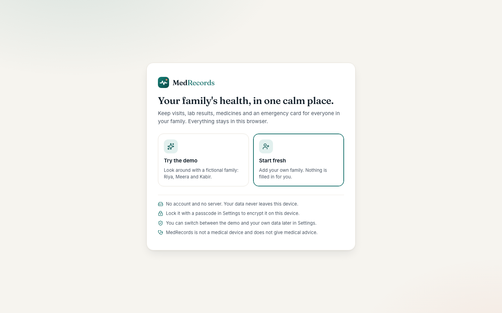
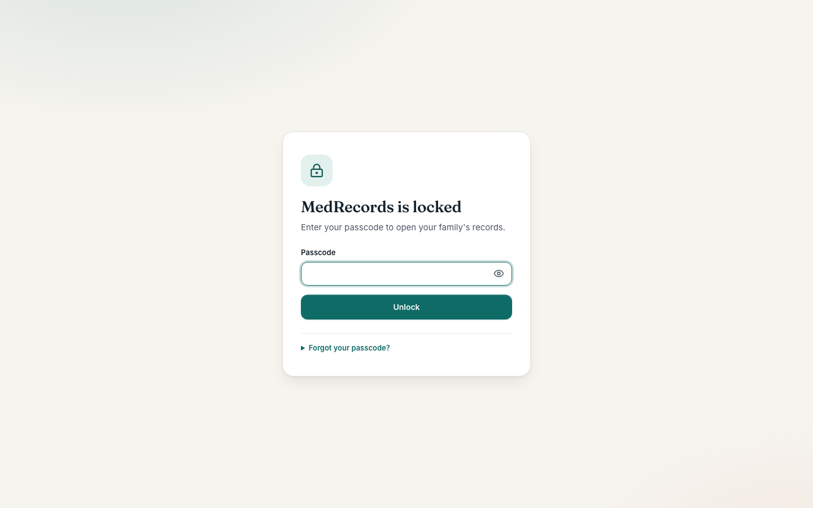

<div align="center">


# MedRecords

**Your family's health, in one calm place.**

A privacy-first personal health record hub for the whole family — visits, lab trends, medications and an emergency card — that runs entirely in your browser.

**[Open the app →](https://gargshishirr.github.io/MedRecords/)** · **[How to use it (guide) →](GUIDE.md)**

</div>


> **Try the demo or use it for your family.** On the first visit you choose: explore a fictional demo family, or start fresh with your own. Everything stays in this browser on this device. There is no backend, no account and no analytics. You can lock it with a passcode to encrypt it. Every person, clinician and phone number in the demo is fictional. MedRecords is not a medical device, and nothing in it is medical advice.

## Features

- **Your family or the demo** — the first visit offers *Try the demo* (Riya, Meera and Kabir, with ~18 months of generated history) or *Start fresh*. You can switch later in Settings.
- **Family members** — add, edit and delete people: name, birth date, sex, blood group, height, allergies, conditions, emergency contacts and primary doctor.
- **Overview dashboard** — vitals snapshot (blood pressure, heart rate, fasting glucose, weight/BMI, SpO₂) with sparklines and *Normal / Watch / High* status from age- and sex-aware reference ranges; add readings; a daily medication checklist; upcoming appointments you can add, edit and delete; latest lab results; allergies & conditions; and, for children, how their vaccines are going.
- **Records timeline** — visits, lab reports, prescriptions, imaging, vaccinations and documents grouped by month, with type filters, search and sorting. Add, edit and delete records with an accessible, validated form, and attach **photos or PDFs** of reports and prescriptions.
- **Lab trends** — hand-built SVG line charts with the reference range as a shaded band, out-of-range points, hover **and keyboard** tooltips and a data table. Add, edit and delete results.
- **Medications** — active and past medicines with dose, schedule and prescriber; a 7-day adherence ring from the checklist; refill countdowns. Add, edit and delete medicines. Adding one warns about a recorded allergy (by medicine family, e.g. a sulfa allergy and Septran), the same medicine twice, or doubling up on paracetamol or painkillers.
- **Reminders** — *Add to calendar* on any medicine or appointment downloads an `.ics` file with alarms, so the phone reminds you even when MedRecords is closed. Optional notifications while the app is open for dose times, appointments and refills; the dose times are yours to set. With the lock on, notifications leave out names and medicines.
- **Doctor summary** — one page with allergies, conditions, current medicines, latest labs (flagged, with change and reference range), latest readings and the last 12 months of visits. Print it or save it as a PDF.
- **Vaccine schedule** — for children under 16, the Indian Academy of Pediatrics schedule from birth to 12 years, worked out from the birth date: what's given, due, overdue and next. Tap a dose to mark it as given.
- **Emergency card** — an ID-card style summary with a QR code that holds plain text only. You choose whether it shows the date of birth, conditions, medicines and doctor. A print stylesheet prints just the card.
- **Passcode lock (optional)** — encrypts all health data in the browser with AES-GCM and a key from your passcode (PBKDF2-SHA-256, 600,000 iterations). Auto-locks after inactivity, locks every open tab, and slows down wrong guesses.
- **Attached files** — photos and PDFs are checked by their bytes (JPEG, PNG, WebP and PDF only), large photos are shrunk and stripped of camera metadata such as GPS location, and every file is encrypted with AES-GCM before it is stored in IndexedDB.
- **Install and offline** — MedRecords is a Progressive Web App: install it to the home screen or dock, and it opens offline.
- **Backups** — export an encrypted (passcode) or plain JSON backup, attached files included; import either. Imports are size-limited and strictly validated.
- **⌘K / Ctrl+K command palette** — jump to any page, record, lab test or medicine, add things, switch people, toggle the theme or lock the app.
- **Settings** — family members, reminders and dose times, the lock, backups, start fresh, demo data, theme and *Install as an app*.

## Screenshots

| | |
|---|---|
|  |  |
| **Records timeline** — filter, search and sort by month | **Record detail** — results with reference ranges |
|  |  |
| **Lab trends** — reference band, flagged points, keyboard tooltips | **Medications** — adherence ring, checklist and refills |
|  |  |
| **Emergency card** — printable, with QR summary | **Dark theme** — full token-based theme |
|  |  |
| **First visit** — try the demo or start fresh | **Lock screen** — data stays encrypted until you unlock |

<p align="center">
  
  <br /><em>Mobile layout with a bottom tab bar (360 px and up)</em>
</p>

## Security & privacy

- **No servers involved.** No backend, no account, no analytics, no third-party requests. Fonts are self-hosted.
- **Encryption at rest (optional).** WebCrypto only: PBKDF2-SHA-256 (600,000 iterations, random 16-byte salt) derives a non-extractable AES-GCM key at unlock. Every save uses a fresh 12-byte IV. Storage holds only `{ v, salt, iv, ct }` — never the passcode or key. While locked, nothing readable is in `localStorage` (the theme setting stays plain).
- **Encrypted files.** Each attached file is encrypted with AES-GCM under a random file key. That key is saved inside the app data, so with the lock on it is itself encrypted by your passcode. Files are only kept if their first bytes really are JPEG, PNG, WebP or PDF, and they are only ever shown through `blob:` URLs whose type comes from that allow-list, so nothing can run as a web page. Backups never include the file key.
- **Offline without leaks.** The service worker caches only the app's own static files; health data stays in `localStorage` and IndexedDB.
- **Hardened import.** 250 MB limit (backups can include files; export refuses to make a backup it couldn't import), strict schema validation that rebuilds every object from a whitelist (unknown keys are dropped), `__proto__` / `constructor` / `prototype` keys are stripped, and errors are written for people.
- **Content-Security-Policy.** Production builds get a CSP `<meta>` tag (`script-src 'self'`, no inline scripts or styles, `object-src 'none'` and more), `referrer: no-referrer`, and a frame guard because a meta CSP can't set `frame-ancestors`.
- **No health data in URLs.** Links between pages pass ids through router state, not the address bar.

## Accessibility & design

- Semantic landmarks, a skip link, labelled controls and visible focus rings throughout.
- Modals use the native `<dialog>` element (focus is moved in and restored, <kbd>Esc</kbd> closes, the page behind is inert).
- Charts are keyboard-navigable and backed by real data tables; toasts are announced via an `aria-live` region.
- Every text/background token pair meets WCAG AA contrast in both light and dark themes.
- Motion (count-ups, ring fills, sparkline drawing, dialog transitions) is disabled under `prefers-reduced-motion`.
- Responsive from 360 px to 1440 px+: sidebar on desktop, icon rail on tablets, bottom tab bar on phones, with no horizontal scrolling.

## Tech stack

- **React 18** + **TypeScript** (strict) built with **Vite 5**
- **React Router 6** (`HashRouter`, so deep links work on GitHub Pages)
- Plain CSS with **design tokens** (CSS custom properties) + **CSS Modules** — no UI kit, no Tailwind
- Hand-built **SVG charts** (sparklines, line chart with reference bands, adherence ring)
- **lucide-react** icons, self-hosted **Inter** and **Fraunces** variable fonts via `@fontsource`
- **qrcode** for the emergency-card QR code (lazy-loaded)
- **IndexedDB** for encrypted attachments, and a small build-time **service worker** (no Workbox) for offline use
- `localStorage` persistence with a versioned schema key (`medrecords:data:v1`, or `medrecords:vault:v1` when locked) and strict import validation
- **WebCrypto** (PBKDF2 + AES-GCM) for the optional passcode lock and encrypted backups
- **Vitest** + **Testing Library** + jsdom, **ESLint** (flat config, typescript-eslint, react-hooks)
- **GitHub Actions** — CI on pull requests, then GitHub Pages deployment from `main`

## Getting started

Requires Node.js 20+ (22 recommended).

```bash
git clone https://github.com/gargshishirr/MedRecords.git
cd MedRecords
npm install
npm run dev
```

Then open the URL Vite prints (usually http://localhost:5173). Choose **Try the demo** or **Start fresh**. You can switch later in **Settings**.

## Scripts

| Script | What it does |
| --- | --- |
| `npm run dev` | Start the Vite dev server with hot reload |
| `npm run build` | Type-check (`tsc -b`) and build to `dist/` |
| `npm run preview` | Serve the production build locally |
| `npm run lint` | Run ESLint (fails on any warning) |
| `npm test` | Run the Vitest suite once |
| `npm run typecheck` | Type-check without building |

## Project structure

```
.
├── .github/workflows/
│   ├── ci.yml                     # Lint, typecheck, test and build every pull request
│   └── deploy.yml                 # Same checks, then deploy to GitHub Pages on push to main
├── docs/screenshots/              # README images
├── public/
│   ├── favicon.svg                # SVG logo mark
│   └── theme-init.js              # Theme before first paint + frame guard (no inline scripts)
├── index.html
├── vite.config.ts                 # base: './' for GitHub Pages; build-only CSP plugin
├── GUIDE.md                       # Short guide: use, keep safe, maintain
└── src/
    ├── main.tsx / App.tsx         # Entry point, providers, welcome/lock gate and routes
    ├── styles/                    # tokens.css (light + dark design tokens), global.css
    ├── lib/                       # Framework-free logic (unit tested)
    │   ├── types.ts               # Data model
    │   ├── seed.ts                # Deterministic fictional demo data (~18 months)
    │   ├── store.ts               # Storage keys and pure add/edit/delete updates
    │   ├── validate.ts            # Strict schema validation for stored data and imports
    │   ├── crypto.ts              # PBKDF2 + AES-GCM encryption (WebCrypto)
    │   ├── backup.ts              # Plain and encrypted backup files
    │   ├── throttle.ts            # Growing delays after wrong passcodes
    │   ├── forms.ts, recordForm.ts # Form validation
    │   ├── ranges.ts              # Reference ranges + normal/watch/high/low classification
    │   ├── meds.ts                # Dose schedule, adherence and refill calculations
    │   └── date.ts, format.ts, selectors.ts, hooks.ts
    ├── state/                     # React context: data store + lock, theme, toasts, idle timer
    ├── components/
    │   ├── gate/                  # Welcome screen and lock screen
    │   ├── family/                # Add/edit family member form and dialog
    │   ├── forms/                 # Shared form pieces (errors, passcode input, actions)
    │   ├── shell/                 # App shell: sidebar, top bar, bottom nav, profile switcher
    │   ├── charts/                # Sparkline, LineChart, Ring (pure SVG)
    │   ├── ui/                    # Button, Card, Dialog, Field, Pill, Avatar, EmptyState
    │   └── CommandPalette.tsx, Logo.tsx, …
    └── pages/                     # Overview, Records, Labs, Medications, Emergency, Settings
```

## Deployment

Pull requests (and pushes to other branches) run `.github/workflows/ci.yml`: lint, typecheck, test and build.

Pushing to `main` runs `.github/workflows/deploy.yml`, which lints, tests and builds the app, then publishes `dist/` to the `gh-pages` branch. GitHub Pages serves that branch (**Settings → Pages → Source: Deploy from a branch → `gh-pages` / root**). So merging a pull request into `main` makes it live.

## Privacy

MedRecords never sends data anywhere. Everything lives in this browser's `localStorage`: under `medrecords:data:v1`, or encrypted under `medrecords:vault:v1` when a passcode is set. You can export, import or wipe it from Settings. Clearing the site's data in the browser deletes it completely, so export backups regularly.

If you forget the passcode, the data cannot be recovered. Keep a backup.

---

Built by [Shishir Garg](https://github.com/gargshishirr).
